<div align="center">

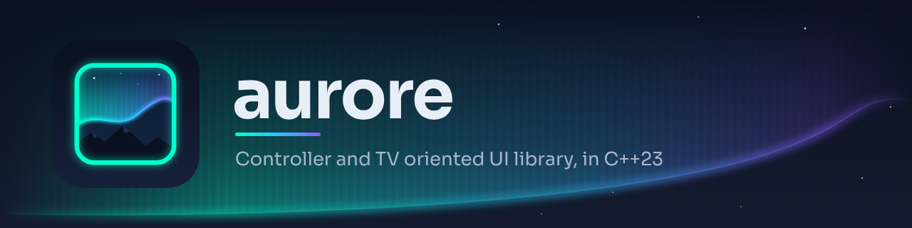

### A Switch-like interface for your app, on every screen

**Android · iOS · Windows · macOS · Linux · PS4 · PS&nbsp;Vita · Nintendo&nbsp;Switch**

[](https://github.com/JigSawFr/Aurore/actions/workflows/ci.yaml?query=branch%3Amain)
[](#-under-the-hood)
[](https://github.com/xfangfang/borealis)
[](#-license-and-credits)

[**Website**](https://aurore.boreale.dev/) ·
[**Try&nbsp;it**](https://aurore.boreale.dev/demo/) ·
[**What's new**](#-what-aurore-adds) ·
[**Under&nbsp;the&nbsp;hood**](#-under-the-hood) ·
[**Use&nbsp;it**](#-use-it-in-your-project) ·
[**Build&nbsp;the&nbsp;demo**](#-build-the-demo) ·
[**Upstream&nbsp;wiki**](https://github.com/xfangfang/borealis/wiki)

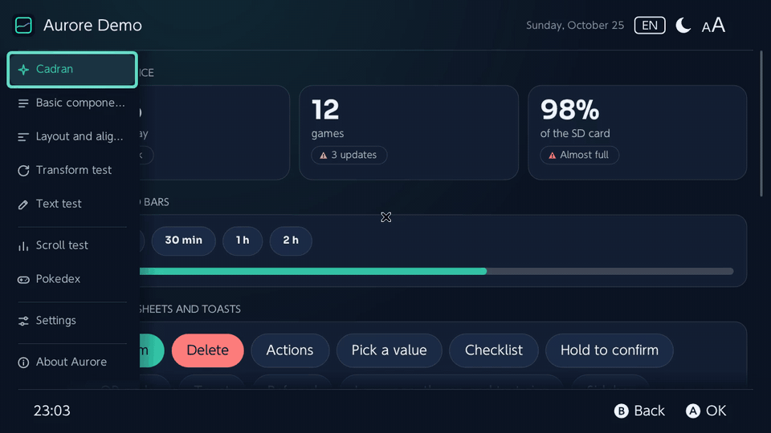

</div>

---

Aurore is a C++ UI library for controllers, TVs and touch screens. It looks like the Nintendo Switch's own menus out of the box, and can be restyled into anything else.

It is [borealis](https://github.com/natinusala/borealis) under a new name: a fork of [xfangfang/borealis](https://github.com/xfangfang/borealis) (the `wiliwili` branch), maintained by [JigSawFr](https://github.com/JigSawFr) for [PlayGuard](https://github.com/JigSawFr/playguard) and [PlayShelf](https://github.com/JigSawFr/playshelf). It follows upstream and adds **fixes and features picked from other forks** and **the changes those apps need**, each one opt-in unless it is a fix. Its code has its own names (`aurore::`, `<aurore.hpp>`, `AURORE_`), in place of borealis' (`brls::`, `<borealis.hpp>`, `BRLS_`): a borealis app moves to Aurore by changing its submodule and renaming them, a search and replace ([migrating from borealis](docs/migrating-from-borealis.md)).

> [!IMPORTANT]
> **[Cadran](docs/cadran.md)**, the look of PlayGuard and PlayShelf (an icon rail, cards, modals, action sheets, vector icons, 15 languages, language and theme switched while the app runs), is Aurore's look: an app gets it without a line of code. Cadran is **GPLv3**: an app built with Aurore is GPLv3.

## ✨ Features

- 🎮 **Made for controllers** — focus moves on its own with the D-pad, touch and mouse work too.
- 🧱 **Flexbox layout** — every view is laid out by [Yoga](https://github.com/facebook/yoga), described in XML, code only where it matters.
- 🖌️ **Vector graphics** — hardware-accelerated by [nanovg](https://github.com/memononen/nanovg) (OpenGL, SDL_GPU's Direct3D 12, Metal and Vulkan, deko3d, GXM, citro3d), scaled for a TV.
- 🧩 **Ready-made components** — tabs, lists that recycle their cells, settings cells, dialogs, toasts, sliders, images, all restyled by a theme.
- 🎨 **Themes** — every colour is a theme key; theme files and folders bring palettes, background pictures, logos, icons and decorations, switched while the app runs ([docs/themes.md](docs/themes.md)). Presets ship with it: high contrast, Ocean, Amethyst, Sand, one per season and feast, and *Seasonal*, which follows the calendar.
- 🌍 **15 languages** — one JSON catalogue per language, switched while the app runs; colour emoji and right-to-left text as options.
- 🧪 **Tools** — a test harness with simulated time and screenshot comparison, an inspector (F12), hot reload of XML and themes, a profiler and an app template.
- 🧰 **The toolbox** — logger, animations, timers, background tasks, storage.

<details>
<summary><b>📸 Screenshots</b></summary>
<br>

<p align="center">
  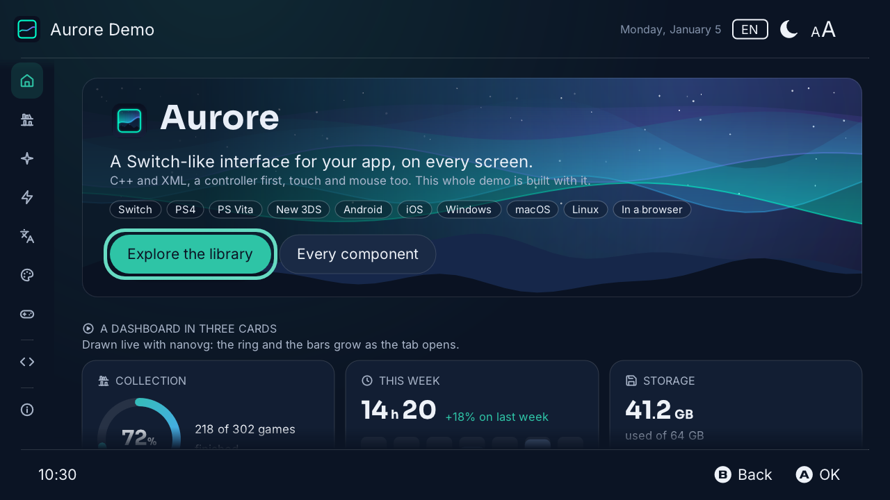
  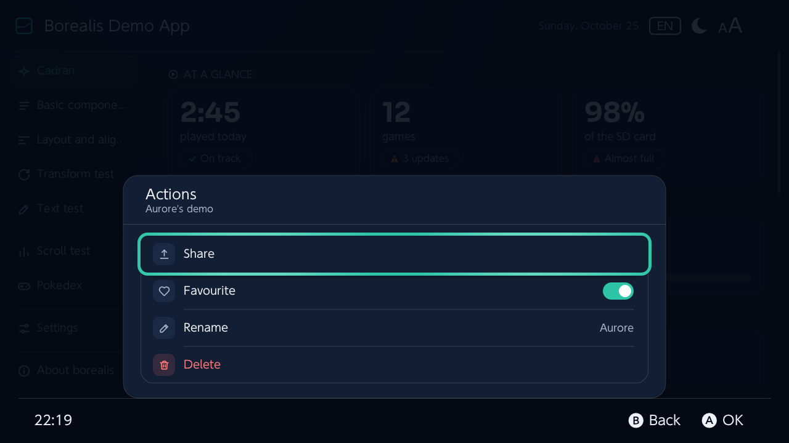
  <br><sub><b>The demo's welcome</b> · <b>An action sheet</b></sub>
</p>

<p align="center">
  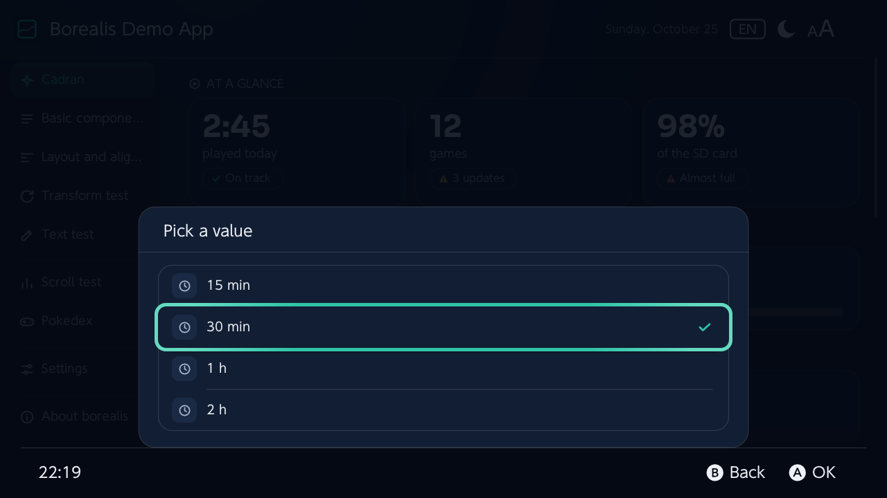
  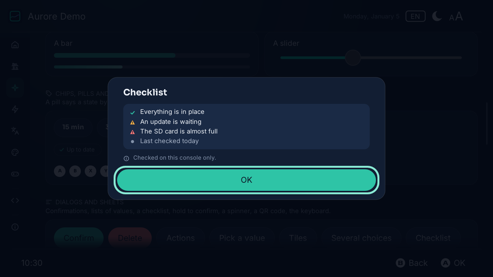
  <br><sub><b>A list of values</b> · <b>A checklist</b></sub>
</p>

<p align="center">
  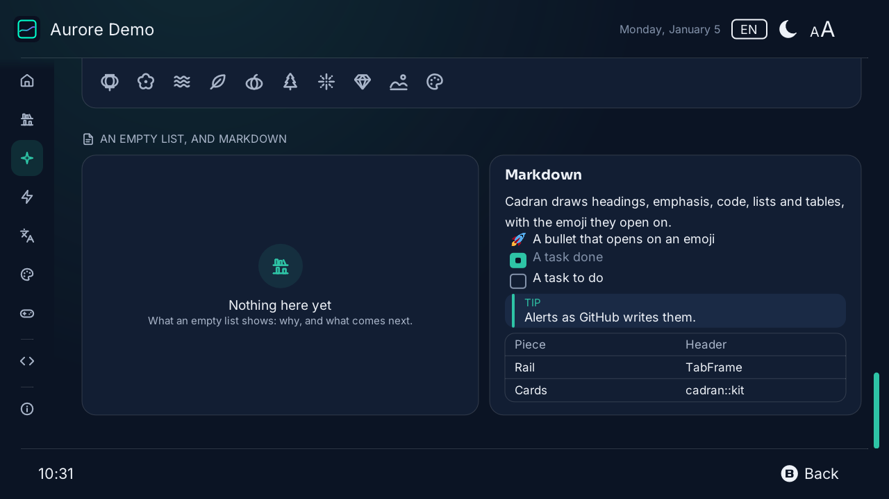
  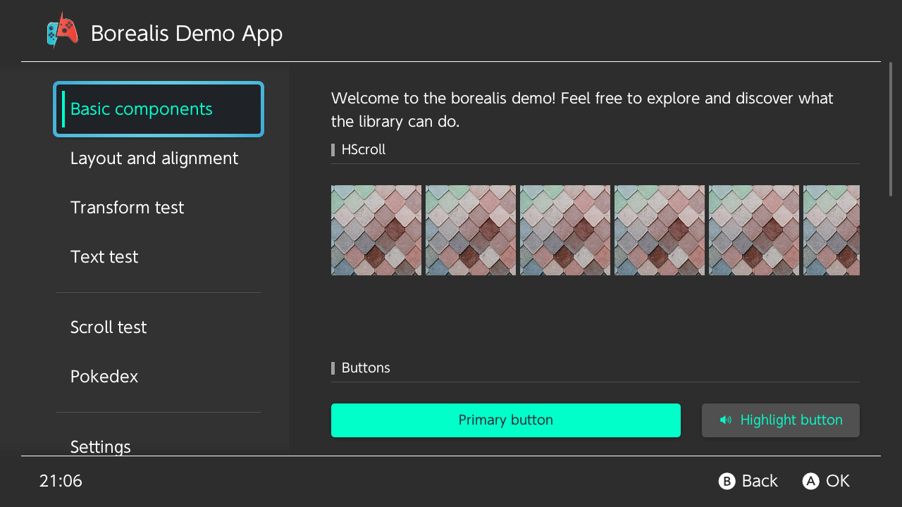
  <br><sub><b>Icons and Markdown</b> · <b>The library: 302 made-up games</b></sub>
</p>

<p align="center">
  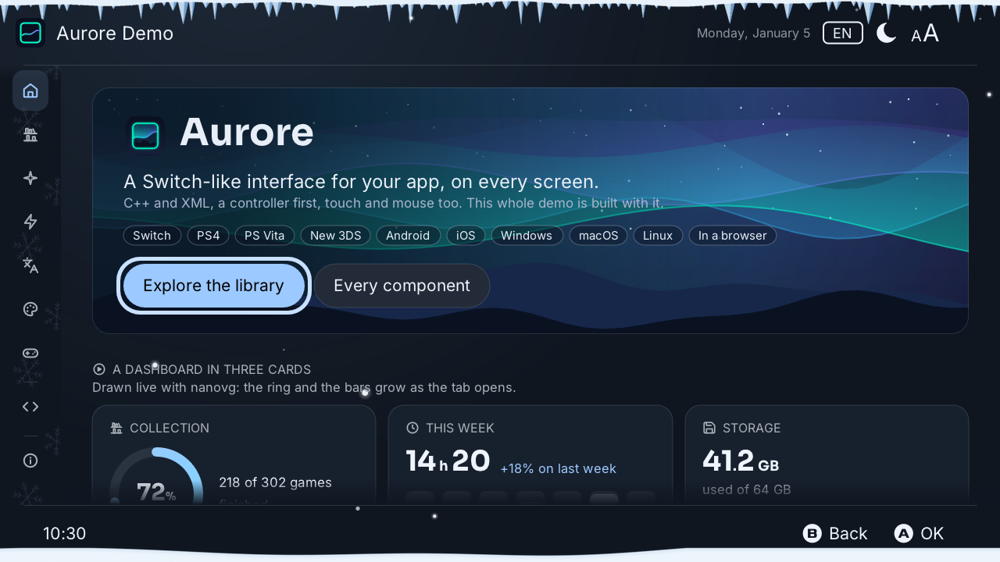
  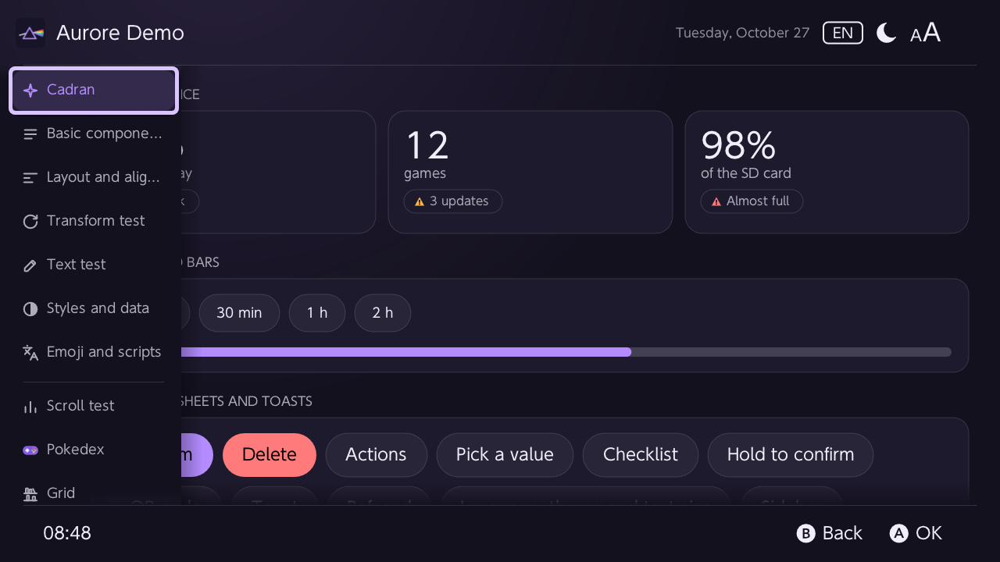
  <br><sub><b>A theme folder with decorations: Winter</b> · <b>A theme with its own logo and icons: Prism</b></sub>
</p>

<p align="center">
  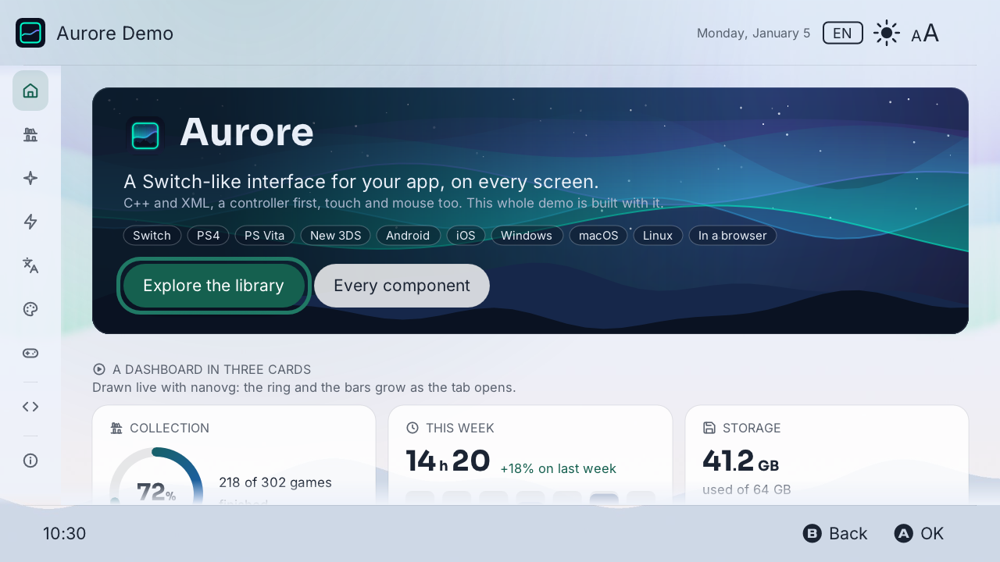
  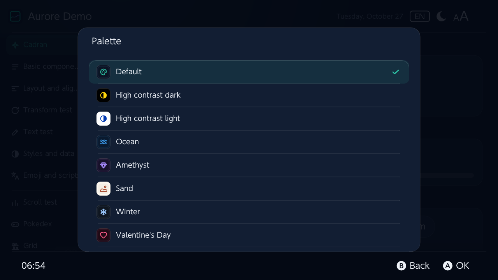
  <br><sub><b>A background picture: Aurora</b> · <b>The palette picker</b></sub>
</p>

<p align="center">
  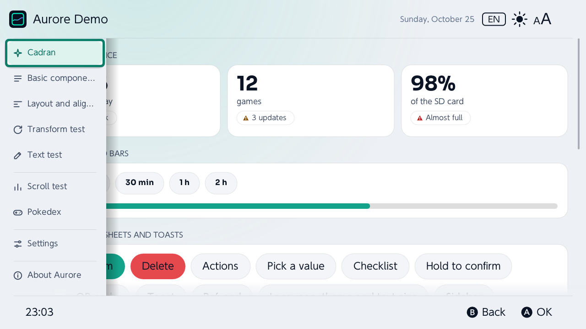
  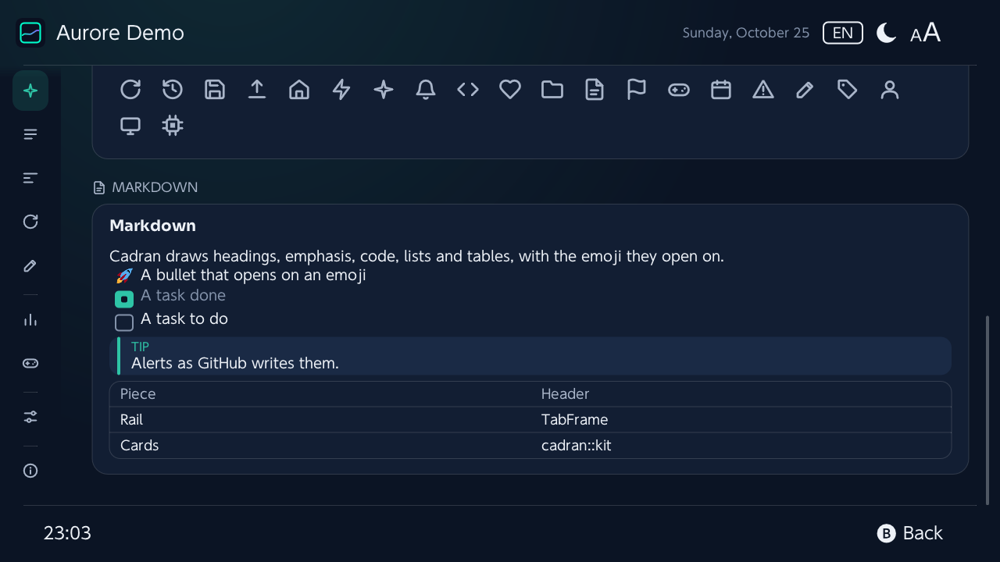
  <br><sub><b>The light theme</b> · <b>In French, switched while the app runs</b></sub>
</p>

</details>

## 🌟 What Aurore adds

- 🎨 **Themes** — theme files and folders: palettes from one accent, presets, background pictures, logos, icons, app image slots, backdrops, decor strips and gentle particles, all switched live, with contrast checked.
- ✨ **Styles** — per-state styles (focus, pressed, disabled, hover), transitions, data binding and accessibility labels.
- 🧩 **Views** — a recycling grid and row, context menus, icon buttons, Markdown.
- 🧪 **Tools** — test harness, inspector, hot reload, profiler, template.
- 📐 **Layout** — Yoga 3; `gap`, `rowGap`, `columnGap`; `flexWrap` with focus across the lines; `boxSizing`, `positionType="static"`; a radius per corner; horizontal gradients; a density for the lengths, `compact:` attributes and presets for a small screen; safe areas, edge to edge (a notch, rounded corners, system bars, a TV's overscan).
- 🔤 **Text** — a font scale for every label, shrink-to-fit, `isTruncated()`, clean line breaks.
- 🌍 **Languages** — switch language while the app runs, with lookups safe from any thread.
- 🎯 **Focus and hints** — no focus lost in hidden or destroyed views; optional and steady footer hints.
- 🖥️ **Platforms** — SDL3 by default (desktop, browser, Android, iOS), SDL2 for the consoles, controllers reconnected under SDL, the browser (Emscripten), the taskbar icon on Linux, deko3d's command memory on the Switch.
- ⚡ **Speed** — no relayout for an unchanged text or size, XML attributes registered on demand, unused textures freed.

Side by side with borealis, change by change: <https://aurore.boreale.dev/borealis/>.

<details>
<summary><b>Every change and its API</b></summary>
<br>

**Themes** ([docs/themes.md](docs/themes.md))

| Change | API |
| --- | --- |
| Every colour by theme key, switched live without rebuilding the screens | `View::setThemeColor`, XML `@theme/…`, `View::onThemeChanged`, `Application::getThemeChangedEvent` |
| Theme files: metadata, `inherit`, `[light]`/`[dark]`, a palette from one accent, `@include` | `Theme::loadFile`, `Theme::inspect`, `Theme::listThemes` |
| Presets: high contrast, Ocean, Amethyst, Sand, nine seasons and feasts, *Seasonal* | `builtin:<id>` · `Theme::seasonalTheme`, `Theme::followCalendar` |
| Contrast checked for every theme (WCAG 4.5:1 and 3:1) | `Theme::addContrastCheck` · `aurore_demo --check-themes` |
| Theme folders with their pictures, kept inside the folder | `<id>/theme.theme` · `Theme::resolveAsset` |
| Background pictures, their fit, a veil, translucent surfaces | `background_image`, `background_fit`, `background_dim`, `surface_opacity` · `Theme::addSurfaceKey` |
| Logo, icons, app image slots, a thumbnail | `logo`, `icon.<name>`, `image.<slot>`, `preview` · `Theme::addImageSlot`, `Image::setThemeImage` |
| Backdrops, decor strips, particles (still with reduced motion) | `backdrop.*`, `decor.*`, `particles*` · `View::setThemeArea` |
| Cadran's palette picker, each palette with a swatch and a motif | `ui::pick_palette` · `icon =` |

**Styles, views and tools**

| Change | API |
| --- | --- |
| Styles per state, transitions, data binding, accessibility | [docs/styles.md](docs/styles.md) |
| Recycling grid and row, context menu, icon button | [docs/components.md](docs/components.md) |
| A test harness: no window, simulated time, inputs by call, screenshots compared | `-DAURORE_BUILD_TESTS=ON` · [docs/testing.md](docs/testing.md) |
| An inspector drawn over the app, on every platform | F12 or L3+R3 · [docs/inspector.md](docs/inspector.md) |
| Hot reload of the XML and the theme on the desktop | [docs/hot_reload.md](docs/hot_reload.md) |
| Frame profiler | `Profiler::setEnabled(true)`, or `AURORE_PROFILE=1` outside release builds |

**Layout and drawing**

| Change | API |
| --- | --- |
| Gaps between a box's children | `gap`, `rowGap`, `columnGap` (XML) · `Box::setGap`, `setRowGap`, `setColumnGap` |
| Wrapping boxes, focus moving across their lines | `flexWrap="wrap"` · `Box::setWrap` |
| Yoga 3.2, standard CSS flexbox | `Application::getYogaConfig()` |
| Width and height measured with or without padding and border | `boxSizing="borderBox"` (default) or `"contentBox"` · `View::setBoxSizing` |
| A view whose position offsets are ignored and that absolute children skip to find their reference | `positionType="static"` · `PositionType::STATIC` |
| A radius for each corner | `cornerTopLeftRadius`… (XML) · `View::setCornerRadius(tl, tr, br, bl)` |
| A density for the lengths (comfortable, compact, dense), the text untouched; lengths in `dp` | `16dp` (XML) · `Application::setDensity`, `aurore::dp()` · `AURORE_DENSITY` · [docs/styles.md](docs/styles.md#density-of-the-lengths) |
| Classes of screen width (compact, medium, expanded), and attributes for one of them | `compact:`, `medium:`, `expanded:` (XML) · `Application::getWidthClass` |
| A small screen's design size, density and text scale in one go | `Application::usePreset(PRESET_SMALL_SCREEN)` · `Platform::getLayoutPreset` · `AURORE_PRESET` |
| Safe areas: notches, rounded corners and system bars (Android, iOS), a TV's overscan kept clear, backgrounds still edge to edge | `safeArea="…"` (XML) · `Box::setSafeArea`, `Application::getSafeArea`, `Application::setOverscan` · `AURORE_SAFE_AREA` · [docs/safe-areas.md](docs/safe-areas.md) |
| Horizontal gradient background, gradients from code | `background="horizontal_linear"` · `View::setBackgroundLinearGradient` |
| `imageAlign` honoured for `FIT` and `FILL` | — |
| Pictures larger than 4096×4096 pixels (or 16384 on a side) refused from their header, before decoding; PNG and JPEG only | `NVG_MAX_IMAGE_PIXELS`, `nvgDecodeImage`, `nvgDecodeImageMem` |
| A spinner's own colour | `ProgressSpinner::setColor` |
| Toasts styled by the theme, with an optional icon | `aurore/notification/background`, `…/text`, `…/corner_radius`, `…/spacing`, `…/margin_top`, `…/margin_right` · `Application::notify(text, leading)` |
| The footer's clock in hours and minutes | — |

**Text**

| Change | API |
| --- | --- |
| A font scale for every label, a cap per label, shrink-to-fit on one line | `Label::setFontScale`, `setFontScaled`, `setFontScaleMax`, `setShrinkToFit` · `setHintsFontScaleMax` |
| A label tells when it is cut with "…" | `Label::isTruncated` |
| A wrapped line no longer starts with a space; a no-break space keeps words together | — |
| The default font looked up for each new label | — |
| Free fonts off the Switch (Inter, PromptFont's buttons at the Switch's code points); Chinese, Japanese and Korean from the system (fontconfig, CoreText…) or the app's `font/cjk` | [docs/fonts.md](docs/fonts.md) |
| FreeType instead of stb_truetype, hinted (an option) | `-DAURORE_FREETYPE=ON`: the system's FreeType on desktop, `switch-freetype` on Switch |
| stb_truetype: a glyph read within its own data, a font's tables within the font (CVE-2026-18497); fonts still from trusted sources | — |
| Colour emoji (CBDT, sbix and COLR fonts) in any label, with FreeType | `FontLoader::USER_EMOJI_PATH`; on desktop, the system's emoji font when it is empty |
| Hebrew and Arabic in reading order, Arabic letters joined (an option) | `-DAURORE_FRIBIDI=ON` · `aurore::bidiVisual()` |

**Languages**

| Change | API |
| --- | --- |
| Load another language while the app runs | `aurore::loadTranslations(locale)` |
| Lookups safe from other threads while the language changes | — |
| Lookups without exceptions (about 6× faster in English) | — |

**Focus, hints and input**

| Change | API |
| --- | --- |
| A hidden box gives no focus; navigation skips hidden scrolling frames and sliders | — |
| A destroyed view is forgotten as the focus; an empty focus is checked everywhere | — |
| A lost child focus reaches the parent scrolling frames | — |
| Optional footer hints, left out when they do not all fit | `setHintsOptionalOwner(view)` |
| Hints drawn steady while a screen fades | `setHintsSteady(true)` |
| The highlight's glow held still, for stable screenshots | `setHighlightAnimationStill(true)` |
| An extra unblock no longer wraps the input's counter | — |
| A view's id and a button's state read back | `View::getId` · `Button::getState` |
| A callback when a dialog closes | `Dialog::setCloseCallback` |

**Platforms**

| Change | API |
| --- | --- |
| SDL3 by default on the desktop (in place of GLFW), in a browser, on Android, iOS and tvOS; SDL2 for the consoles, GLFW and SDL2 kept as options; the face buttons read by their label, as under SDL2 | `AURORE_WINDOW`, `__SDL__` |
| SDL: the right controller closed when one is unplugged, every controller read after a reconnection | — |
| SDL in a browser (Emscripten), with an on-screen pad | `aurore_web_button()` |
| GLFW: Wayland `app_id` and X11 `WM_CLASS`, for the taskbar's icon | `Application::setAppId`, before `createWindow()` |
| deko3d: the command memory grows instead of aborting; image descriptors reused | — |
| Switch: the applet hook removed first at shutdown | — |
| `openBrowser`: http and https links only, handed to `xdg-open`/`open` as one argument (no shell), one line on the Steam Deck pipe | `Platform::isBrowserUrl`, `Platform::BROWSER_URL_SCHEMES` |
| Logger: flushed after every line | — |

**Speed**

| Change | Gain |
| --- | --- |
| The same text or size set again is not laid out again | a refresh: 2.1 → 0.13 ms |
| XML attribute handlers registered the first time one is used | 200 labels built in code: 3–6 → under 1 ms |
| Cached textures freed once nothing uses them | — |
| Views queued while the deletion pool drains kept; each recycling list checks its own width | — |
| Text measures kept per text and style (`nvgTextBounds`, `nvgTextBoxBounds`) | a measure: 2.1 → 0.18 µs; 95% of the demo's answered from the cache |

Each commit says what it changes, why, and where it comes from: `git log 5f08b28..`.

</details>

## 🔩 Under the hood

<!-- under-the-hood: begin (tools/stack.py writes this) -->
| | Version |
| --- | --- |
| Language | C++20 |
| CMake | 3.16–3.31 |
| SDL3 | 3.4.18 |
| SDL | 2.32.10 |
| GLFW | 3.5.1 |
| glad | 2.0.8 |
| Yoga | 3.2.1 |
| {fmt} | 12.2.0 |
| TinyXML-2 | 11.0.0 |
| JSON for Modern C++ | 3.12.0 |
| stb_image | 2.30 |
| stb_truetype | 1.26 |
| Tweeny | 4.2.0 |
| Twemoji | 17.0.3 |
| Android Gradle Plugin | 9.5.0 |
| Gradle | 9.8.2 |
| Android NDK | r30 |
| Android API | 36 |
| Emscripten | 6.0.13 |

Checked on every pull request: 157 test cases in the headless harness, 34 reference screenshots compared pixel by pixel, and 153 checks of Cadran's text code; 42 CI jobs build every platform, consoles included; the demo runs under AddressSanitizer and UndefinedBehaviorSanitizer, and in headless Chromium for its build in a browser; Markdown and theme files are fuzzed; a build fails on a deprecated API; every file says its licence (REUSE); 57 of the 57 GitHub Actions used are pinned to a commit; every Monday, `tools/check_upstream.py` compares the bundled components with their upstream's latest release and keeps an issue open with those behind. The versions are those of the build files and [`THIRD_PARTY_NOTICES.md`](resources/THIRD_PARTY_NOTICES.md), which `tools/check_notices.py` checks against the sources; `tools/stack.py` writes this section.
<!-- under-the-hood: end -->

## 📦 Use it in your project

1. Build your project as **C++20**, without `-fno-rtti` or `-fno-exceptions`.
2. Add Aurore as a submodule:

   ```sh
   git submodule add -b main https://github.com/JigSawFr/aurore.git library/aurore
   git submodule update --init --recursive
   ```

3. Copy its `resources` folder to the root of your project.
4. In your `CMakeLists.txt`, include `library/aurore/library/cmake/commonOption.cmake` and `toolchain.cmake` before `project()`, `add_subdirectory(library/aurore/library)` after it, and link `Aurore::aurore`. It brings its include directories, definitions and dependencies with it.

   The build options are prefixed: `AURORE_PLATFORM` (`DESKTOP`, `SWITCH`, `PSV`, `PS4`, `3DS`, `ANDROID`, `IOS`, `TVOS`), `AURORE_WINDOW` (`SDL3`, `GLFW`, `SDL2`), `AURORE_GRAPHICS` (`GL3`, `GL2`, `GLES2`, `GLES3`, `DEKO3D`, `GXM`, `SDLGPU`), `AURORE_LIBROMFS`, `AURORE_FREETYPE`, `AURORE_FRIBIDI`… ([`commonOption.cmake`](library/cmake/commonOption.cmake) lists them). Only these are read; `PLATFORM_DESKTOP`, `USE_GLFW`, `USE_DEKO3D`… are then set as plain variables for the app's own tests.

   On the desktop, `-DAURORE_INSTALL=ON` (with `AURORE_LIBROMFS=OFF`) installs the library instead, for `find_package(Aurore)` and `Aurore::aurore`.

5. Pick a version: the submodule can follow a release tag (`vX.Y.Z`), and [`CHANGELOG.md`](CHANGELOG.md) says what each one changes. Before 1.0 a minor version may break the API. In code, `AURORE_VERSION` and `AURORE_VERSION_AT_LEAST(0, 2, 0)` come with `aurore.hpp`; an installed Aurore answers `find_package(Aurore 0.1)`.

> [!TIP]
> Starting from scratch? Copy [**`template/`**](template/README.md): a minimal app (one XML screen, its strings, an icon) whose CMake builds a desktop binary and a Switch `.nro` with Aurore as a submodule. Upstream's [template](https://github.com/xfangfang/borealis_template) has the build files for the other platforms.

## 🛠️ Build the demo

The demo is a guided tour of Aurore, a tab per subject, each saying what it shows. It runs in a browser too: <https://aurore.boreale.dev/demo/>.

- **Welcome**: Aurore in a sentence over an aurora drawn with nanovg, a dashboard of live cards (a ring, bars, figures), a tile per tab.
- **Library**: 302 made-up games, their covers drawn in code, in a grid that keeps only the cells on screen; sorted, filtered by genre, a menu on each, a page for each with a row of games like it; the same games by genre in a long recycled list.
- **Components**: borealis' button styles and Cadran's, cells in cards, bars, chips, pills, keys, every dialog, sheet and toast, images, icons, an empty list, Markdown, and a screen of settings cells.
- **Motion**: easings drawn and played, state styles and their transitions (XML only), the focus gliding and shaking, reduced motion, the transform lab.
- **Text and languages**: the 15 languages switched live, the text sizes, scripts and emoji, long texts (scrolling, shrinking, wrapping), the text lab.
- **Themes**: light or dark, every palette used at once (Cadran's, the demo's files with Boréale's night, Aurore's presets), a theme file in a few lines.
- **Input**: a controller drawn as the app reads it, with a test mode; touch and mouse traces; the keyboard's keys; the footer's hints.
- **For developers**: the frame measured live, the inspector, the debug layer, redraw on demand, the layout lab, data binding and what a screen reader would say, how a page is written.
- **About Aurore**: credits and licences.

On Windows, macOS or Linux:

```sh
git clone --recursive https://github.com/JigSawFr/aurore.git
cd aurore
cmake -B build_pc -DAURORE_PLATFORM=DESKTOP
cmake --build build_pc
./build_pc/aurore_demo
```

Aurore builds with CMake only (3.16 or later): upstream's xmake files (`xmake.lua`, `uwp.lua`), untested and behind the CMake build, are gone.

With CMake 3.25 or later and Ninja, the presets in `CMakePresets.json` do the same for the usual targets, in `build/<preset>` (`cmake --list-presets`: also `desktop-debug`, `desktop-asan` and `tests`):

```sh
cmake --preset desktop-sdl3        # or desktop-glfw, desktop-sdl (SDL2)
cmake --build --preset desktop-sdl3
./build/desktop-sdl3/aurore_demo
cmake --workflow --preset tests    # configure, build and run the tests

export DEVKITPRO=/opt/devkitpro    # Switch: switch-deko3d or switch-gl (OpenGL)
cmake --preset switch-deko3d
cmake --build --preset switch-deko3d   # build/switch-deko3d/aurore_demo.nro
```

With the resources built in (`AURORE_LIBROMFS`), `AURORE_RESOURCES_DIR` makes the app read a file from that folder first, falling back to the built-in copy: `AURORE_RESOURCES_DIR=resources ./build/desktop-sdl3/aurore_demo` picks up changed XML, images or translations without a rebuild, only a restart.

New to it? [**Aurore in 15 minutes**](docs/getting-started.md) goes from the demo to a screen of your own on the Switch. `./build_pc/aurore_demo -t winter` (or `aurora`, `prism`, `builtin:halloween`…) starts it with a theme, and `--simulate 3ds` (or `switch`, `vita`, `ps4`, `phone`) on a console's screen, the console drawn around it ([platforms.md](docs/platforms.md#simulated-platforms)). The [API reference](https://aurore.boreale.dev/api/) has every class, sorted by theme, and two debugging aids are a switch away: the [inspector](docs/inspector.md) (F12) and [hot reload](docs/hot_reload.md) of the XML and the theme.

The other platforms (Windows, macOS, the Switch, PS Vita, PS4, the New 3DS, Android, iOS, a browser) have their toolchains and commands, the CI's, in [**docs/platforms.md**](docs/platforms.md).

## 📚 Documentation

Also on the website, with a search and the API reference: <https://aurore.boreale.dev/>, in the consoles' 15 languages (these pages in English under each language's header). Its home page shows the demo on a console, a screen's XML and its activity in an editor's window beside the screen they draw, the features, Cadran and the screenshots; the demo runs there in a browser: <https://aurore.boreale.dev/demo/>. How the site is made: [site/README.md](site/README.md).

| Page | |
| --- | --- |
| [Aurore in 15 minutes](docs/getting-started.md) | From the demo to a screen of your own on the Switch |
| [Migrating from borealis](docs/migrating-from-borealis.md) | The submodule, the CMake target, the resources, Cadran, what changes on screen |
| [Platforms](docs/platforms.md) | Building on Linux, macOS, Windows, the Switch, PS Vita, PS4, the New 3DS, Android, iOS and in a browser; the consoles simulated on the desktop |
| [Porting an app](docs/porting.md) | What an app's code and resources should mind on each platform |
| [Architecture](docs/architecture.md) | The layers, the main loop, layout, focus, ownership, themes, platforms, threads, resources |
| [Views](docs/views.md) | Every XML tag, its class and its header |
| [Themes](docs/themes.md) | Theme files and folders, presets, pictures, decorations, keys |
| [Cadran](docs/cadran.md) | The look and its kit |
| [Styles](docs/styles.md) | State styles, transitions, data binding, accessibility |
| [Components](docs/components.md) | The views Aurore adds |
| [Safe areas](docs/safe-areas.md) | Notches, rounded corners, system bars and a TV's overscan kept clear, edge to edge |
| [XML attributes](docs/xml-attributes.md) | Every attribute of every view, generated from the sources |
| [Keyboard and mouse](docs/input.md) | The keys for the controller's buttons, the mouse |
| [Testing](docs/testing.md) | The test harness |
| [Fonts](docs/fonts.md) | The fonts on each platform, the buttons' code points, Chinese, Japanese and Korean |
| [Inspector](docs/inspector.md) · [Hot reload](docs/hot_reload.md) | Debugging aids |
| [Environment variables](docs/environment.md) | Every variable Aurore reads, for debugging and tests |
| [Overlay](docs/overlay.md) | Design note on a Switch overlay mode (not built) |

## 🕹️ Made with borealis

| Project | |
| --- | --- |
| [Moonlight-Switch](https://github.com/XITRIX/Moonlight-Switch) | Moonlight game streaming for Nintendo Switch |
| [PlayGuard](https://github.com/JigSawFr/playguard) | Parental controls for Nintendo Switch, on the console |
| [PlayShelf](https://github.com/JigSawFr/playshelf) | A game library, catalogue and downloads for Nintendo Switch |
| [SimpleModDownloader](https://github.com/PoloNX/SimpleModDownloader) | GameBanana mods, downloaded on the Switch |
| [switchfin](https://github.com/dragonflylee/switchfin) | Jellyfin client for PC, PS4 and Nintendo Switch |
| [UpcomingSwitchGames](https://github.com/PoloNX/UpcomingSwitchGames) | The upcoming Switch games |
| [wiliwili](https://github.com/xfangfang/wiliwili) | bilibili client for PC, PS4, PS Vita, Xbox and Nintendo Switch |

## 🤝 Contributing

[`CONTRIBUTING.md`](CONTRIBUTING.md) has the build, the tests, the format and the rules for pull requests; [`SECURITY.md`](SECURITY.md) says how to report a vulnerability privately. The default branch is `main`; upstream's is `wiliwili`. Picks from upstream and other forks keep their author and their `cherry picked from` line; commits follow [Conventional Commits](https://www.conventionalcommits.org/).

## 📜 License and credits

borealis' code is **Apache 2.0** ([`LICENSE`](LICENSE)); Cadran is **GPLv3** ([`LICENSE.GPL`](LICENSE.GPL)), and so is an app built with it. [`NOTICE`](NOTICE) says which is which, and [`resources/THIRD_PARTY_NOTICES.md`](resources/THIRD_PARTY_NOTICES.md) lists what is bundled (the libraries in `library/lib/extern`, Inter, PromptFont, Sora, Material Icons, Twemoji) with its licence. Maintained by [JigSawFr](https://github.com/JigSawFr).

<details>
<summary>Credits</summary>
<br>

- borealis was created by [natinusala](https://github.com/natinusala/borealis) and its [contributors](AUTHORS); carried on by [xfangfang](https://github.com/xfangfang/borealis) and [dragonflylee](https://github.com/dragonflylee).
- Changes picked from the forks of Nika0000, Kelvin Wong, kawaii-flesh, Alexander Kiselev, youngzyl, Elias da Rosa, XITRIX, CostelaBR, PalindromicBreadLoaf and xlanor, each commit keeping its author.
- Built on [nanovg](https://github.com/memononen/nanovg), [Yoga](https://github.com/facebook/yoga), [GLFW](https://www.glfw.org/), [SDL](https://www.libsdl.org/), [tinyxml2](https://github.com/leethomason/tinyxml2), [fmt](https://github.com/fmtlib/fmt), [nlohmann/json](https://github.com/nlohmann/json), [tweeny](https://github.com/mobius3/tweeny) and the others in `library/lib/extern`, under their own licences.
- The text font is [Inter](https://rsms.me/inter/) and the controller buttons come from [PromptFont](https://shinmera.com/promptfont) by Shinmera (Yukari Hafner), both under the SIL Open Font License.
- The demo's logo by @MeganRoshelle; Aurore's icon and banner in [`.github/branding`](.github/branding).

</details>

<sub>Aurore is not affiliated with or endorsed by Nintendo. Nintendo Switch is a trademark of Nintendo.</sub>
