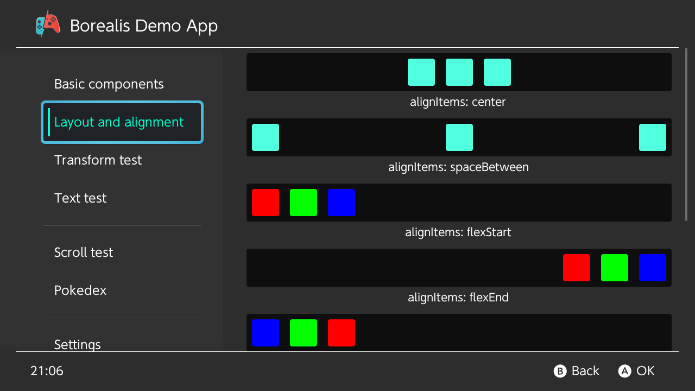
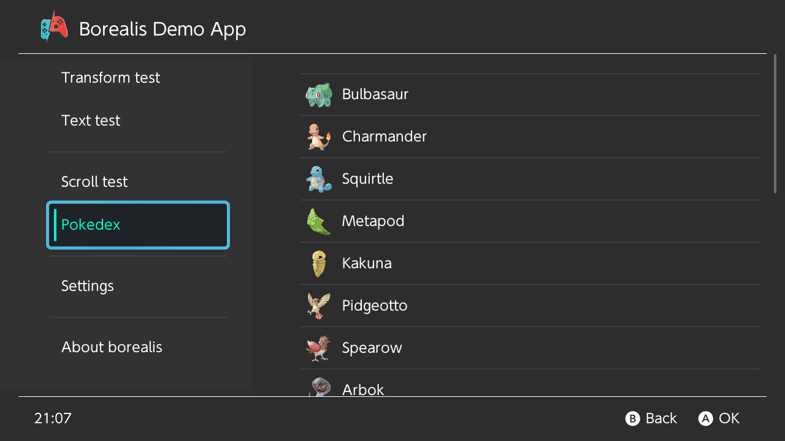
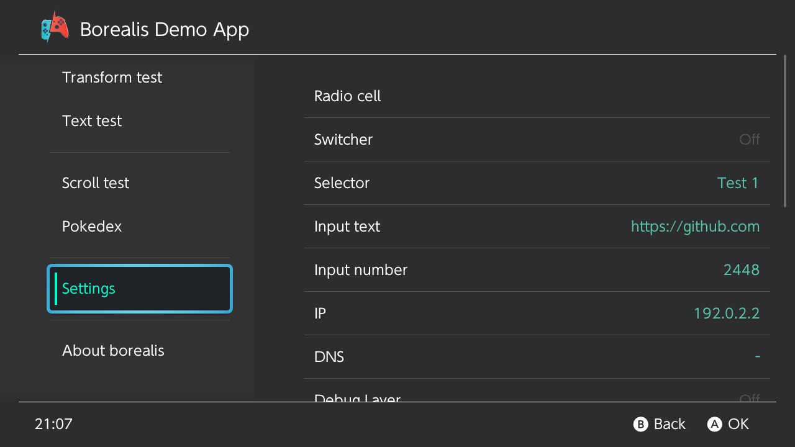

<div align="center">


### A Switch-like interface for your app, on every screen

**Android · iOS · Windows · macOS · Linux · PS4 · PS&nbsp;Vita · Nintendo&nbsp;Switch**

[](#-use-it-in-your-project)
[](https://github.com/xfangfang/borealis)
[](LICENSE)

[**What's new here**](#-what-this-fork-adds) ·
[**Use&nbsp;it**](#-use-it-in-your-project) ·
[**Build&nbsp;the&nbsp;demo**](#-build-the-demo) ·
[**Upstream&nbsp;wiki**](https://github.com/xfangfang/borealis/wiki)


</div>

---

borealis is a C++ UI library for controllers, TVs and touch screens. It looks like the Nintendo Switch's own menus out of the box, and can be restyled into anything else.

This is [JigSawFr](https://github.com/JigSawFr)'s fork of [xfangfang/borealis](https://github.com/xfangfang/borealis) (the `wiliwili` branch, itself from [natinusala/borealis](https://github.com/natinusala/borealis)), maintained for [PlayGuard](https://github.com/JigSawFr/playguard). It follows upstream and adds **fixes and features picked from other forks** and **the changes PlayGuard needs**, each one opt-in unless it is a fix.

## ✨ Features

- 🎮 **Made for controllers** — focus moves on its own with the D-pad, touch and mouse work too.
- 🧱 **Flexbox layout** — every view is laid out by [Yoga](https://github.com/facebook/yoga), described in XML, code only where it matters.
- 🖌️ **Vector graphics** — hardware-accelerated by [nanovg](https://github.com/memononen/nanovg) (OpenGL, Direct3D 11, deko3d, GXM), scaled for a TV.
- 🧩 **Ready-made components** — tabs, lists that recycle their cells, settings cells, dialogs, toasts, sliders, images, all restyled by a theme.
- 🌗 **Light and dark themes**, and translations in one JSON catalogue per language.
- 🧰 **The toolbox** — logger, animations, timers, background tasks, storage.

<details>
<summary><b>📸 Screenshots</b></summary>
<br>

<p align="center">
  
  
  <br><sub><b>Basic components</b> · <b>Layout and alignment</b></sub>
</p>

<p align="center">
  
  
  <br><sub><b>A recycling list</b> · <b>Settings cells</b></sub>
</p>

<p align="center">
  
  <br><sub><b>The light theme</b></sub>
</p>

</details>

## 🌟 What this fork adds

- 📐 **Layout** — `gap`, `rowGap`, `columnGap`; `flexWrap` with focus across the lines; a radius per corner; horizontal gradients.
- 🔤 **Text** — a font scale for every label, shrink-to-fit, `isTruncated()`, clean line breaks.
- 🌍 **Languages** — switch language while the app runs, with lookups safe from any thread.
- 🎯 **Focus and hints** — no focus lost in hidden or destroyed views; optional and steady footer hints.
- 🖥️ **Platforms** — controllers reconnected under SDL, the browser (Emscripten), the taskbar icon on Linux, deko3d's command memory on the Switch.
- ⚡ **Speed** — no relayout for an unchanged text or size, XML attributes registered on demand, unused textures freed.

<details>
<summary><b>Every change and its API</b></summary>
<br>

**Layout and drawing**

| Change | API |
| --- | --- |
| Gaps between a box's children | `gap`, `rowGap`, `columnGap` (XML) · `Box::setGap`, `setRowGap`, `setColumnGap` |
| Wrapping boxes, focus moving across their lines | `flexWrap="wrap"` · `Box::setWrap` |
| A radius for each corner | `cornerTopLeftRadius`… (XML) · `View::setCornerRadius(tl, tr, br, bl)` |
| Horizontal gradient background, gradients from code | `background="horizontal_linear"` · `View::setBackgroundLinearGradient` |
| `imageAlign` honoured for `FIT` and `FILL` | — |
| A spinner's own colour | `ProgressSpinner::setColor` |
| Toasts styled by the theme, with an optional icon | `brls/notification/background`, `…/text`, `…/corner_radius`, `…/spacing`, `…/margin_top`, `…/margin_right` · `Application::notify(text, leading)` |
| The footer's clock in hours and minutes | — |

**Text**

| Change | API |
| --- | --- |
| A font scale for every label, a cap per label, shrink-to-fit on one line | `Label::setFontScale`, `setFontScaled`, `setFontScaleMax`, `setShrinkToFit` · `setHintsFontScaleMax` |
| A label tells when it is cut with "…" | `Label::isTruncated` |
| A wrapped line no longer starts with a space; a no-break space keeps words together | — |
| The default font looked up for each new label | — |

**Languages**

| Change | API |
| --- | --- |
| Load another language while the app runs | `brls::loadTranslations(locale)` |
| Lookups safe from other threads while the language changes | — |
| Lookups without exceptions (about 6× faster in English) | — |

**Focus, hints and input**

| Change | API |
| --- | --- |
| A hidden box gives no focus; navigation skips hidden scrolling frames and sliders | — |
| A destroyed view is forgotten as the focus; an empty focus is checked everywhere | — |
| A lost child focus reaches the parent scrolling frames | — |
| Optional footer hints, left out when they do not all fit | `setHintsOptionalOwner(view)` |
| Hints drawn steady while a screen fades | `setHintsSteady(true)` |
| The highlight's glow held still, for stable screenshots | `setHighlightAnimationStill(true)` |
| An extra unblock no longer wraps the input's counter | — |
| A view's id and a button's state read back | `View::getId` · `Button::getState` |
| A callback when a dialog closes | `Dialog::setCloseCallback` |

**Platforms**

| Change | API |
| --- | --- |
| SDL: the right controller closed when one is unplugged, every controller read after a reconnection | — |
| SDL in a browser (Emscripten), with an on-screen pad | `brls_web_button()` |
| GLFW: Wayland `app_id` and X11 `WM_CLASS`, for the taskbar's icon | `Application::setAppId`, before `createWindow()` |
| deko3d: the command memory grows instead of aborting; image descriptors reused | — |
| Switch: the applet hook removed first at shutdown | — |
| Logger: flushed after every line | — |

**Speed**

| Change | Gain |
| --- | --- |
| The same text or size set again is not laid out again | a refresh: 2.1 → 0.13 ms |
| XML attribute handlers registered the first time one is used | 200 labels built in code: 3–6 → under 1 ms |
| Cached textures freed once nothing uses them | — |
| Views queued while the deletion pool drains kept; each recycling list checks its own width | — |

Each commit says what it changes, why, and where it comes from: `git log 5f08b28..`.

</details>

## 📦 Use it in your project

1. Build your project as **C++17**, without `-fno-rtti` or `-fno-exceptions`.
2. Add borealis as a submodule:

   ```sh
   git submodule add -b wiliwili https://github.com/JigSawFr/borealis.git library/borealis
   git submodule update --init --recursive
   ```

3. Copy its `resources` folder to the root of your project.

> [!TIP]
> Starting from scratch? Upstream's [**template**](https://github.com/xfangfang/borealis_template) has the build files for every platform; point its submodule here.

## 🛠️ Build the demo

On Windows, macOS or Linux:

```sh
git clone --recursive https://github.com/JigSawFr/borealis.git
cd borealis
cmake -B build_pc -DPLATFORM_DESKTOP=ON
cmake --build build_pc
./build_pc/borealis_demo
```

For the other platforms, upstream's wiki has the toolchains and the commands:

- 🖥️ [Windows, macOS, Linux](https://github.com/xfangfang/borealis/wiki/Windows-macOS-Linux)
- 🎮 [Nintendo Switch](https://github.com/xfangfang/borealis/wiki/NintendoSwitch) · [PS4](https://github.com/xfangfang/borealis/wiki/PS4) · [PS Vita](https://github.com/xfangfang/borealis/wiki/PS-Vita)
- 📱 [Android](https://github.com/xfangfang/borealis/wiki/Android) · [iOS](https://github.com/xfangfang/borealis/wiki/iOS)

## 🕹️ Made with borealis

| Project | |
| --- | --- |
| [Moonlight-Switch](https://github.com/XITRIX/Moonlight-Switch) | Moonlight game streaming for Nintendo Switch |
| [PlayGuard](https://github.com/JigSawFr/playguard) | Parental controls for Nintendo Switch, on the console |
| [SimpleModDownloader](https://github.com/PoloNX/SimpleModDownloader) | GameBanana mods, downloaded on the Switch |
| [switchfin](https://github.com/dragonflylee/switchfin) | Jellyfin client for PC, PS4 and Nintendo Switch |
| [UpcomingSwitchGames](https://github.com/PoloNX/UpcomingSwitchGames) | The upcoming Switch games |
| [wiliwili](https://github.com/xfangfang/wiliwili) | bilibili client for PC, PS4, PS Vita, Xbox and Nintendo Switch |

## 🤝 Contributing

The default branch is `wiliwili`, as upstream's. Picks from upstream and other forks keep their author and their `cherry picked from` line; commits follow [Conventional Commits](https://www.conventionalcommits.org/). A fix that is not specific to this fork is worth sending [upstream](https://github.com/xfangfang/borealis) too.

## 📜 License and credits

**Apache 2.0**, see [`LICENSE`](LICENSE) and [`NOTICE`](NOTICE). Maintained by [JigSawFr](https://github.com/JigSawFr).

<details>
<summary>Credits</summary>
<br>

- Created by [natinusala](https://github.com/natinusala/borealis) and its [contributors](AUTHORS); carried on by [xfangfang](https://github.com/xfangfang/borealis) and [dragonflylee](https://github.com/dragonflylee).
- Changes picked from the forks of Nika0000, Kelvin Wong, kawaii-flesh, Alexander Kiselev, youngzyl, Elias da Rosa, XITRIX, CostelaBR, PalindromicBreadLoaf and xlanor, each commit keeping its author.
- Built on [nanovg](https://github.com/memononen/nanovg), [Yoga](https://github.com/facebook/yoga), [GLFW](https://www.glfw.org/), [SDL](https://www.libsdl.org/), [tinyxml2](https://github.com/leethomason/tinyxml2), [fmt](https://github.com/fmtlib/fmt), [nlohmann/json](https://github.com/nlohmann/json), [tweeny](https://github.com/mobius3/tweeny) and the others in `library/lib/extern`, under their own licences.
- The demo's logo by @MeganRoshelle; this fork's icon and banner in [`.github/branding`](.github/branding).

</details>

<sub>borealis is not affiliated with or endorsed by Nintendo. Nintendo Switch is a trademark of Nintendo.</sub>
