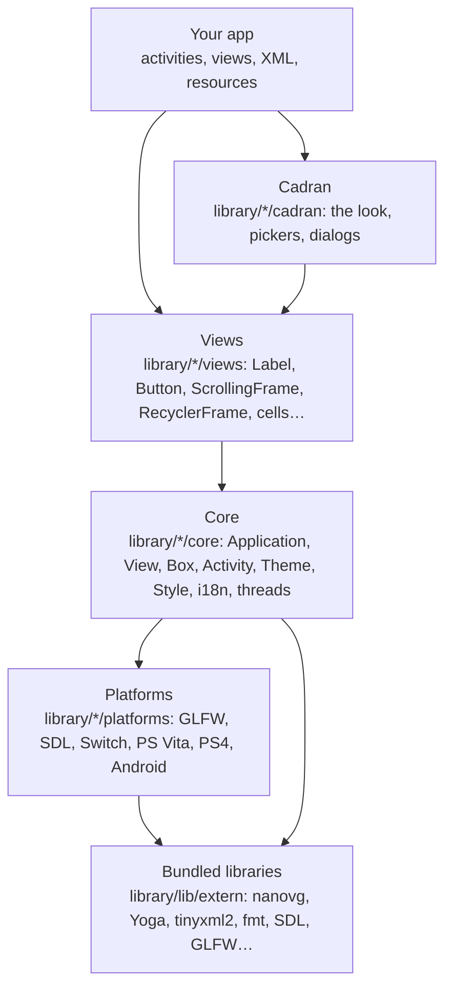

# Architecture

How Aurore is put together: the layers, what happens in a frame, how views are laid out and drawn, how the focus moves, who owns what, and which thread may touch what. For contributors, and for app authors who want to know why something behaves as it does. The [API reference](https://aurore.boreale.dev/api/) has the details of each class.

## Layers



| Folder (`include/aurore/…` and `lib/…`) | What it holds | May include |
| --- | --- | --- |
| `core/` | The application, the base view and box, activities, actions and gestures, the theme and the style, translations, threads, timers, animations, the logger, the inspector, hot reload, the profiler | `core/`, `views/` (the core builds some views itself: dialogs, hints, notifications), `platforms/` only to pick one (`platform.cpp`) |
| `views/` | The views of the library: labels, images, buttons, frames, lists, cells, dialogs, widgets | `core/`, `views/` |
| `platforms/` | One folder per platform, each implementing the core's interfaces | `core/`, `platforms/`; the GLFW and SDL keyboards also show an `EditTextDialog` |
| `cadran/` | Cadran, the look (GPLv3, [cadran.md](cadran.md)) | the public API only, through `<aurore.hpp>` |
| `test/` | The test harness and its headless platform ([testing.md](testing.md)) | `core/`, `platforms/` |
| `extern/` | Bundled libraries, under their own licences | — |

The core calls Cadran from one file, `application.cpp`: `init()` and `createWindow()` start it (`cadran::start`, `cadran::start_window`), and `getReduceMotion()` asks whether its effects are reduced. Nothing else in the core or the views knows about it (the theme only knows its keys, `cadran/…`, as strings): Cadran restyles screens from the outside, through the theme keys, the XML views it registers and the hooks the core already has.

`<aurore.hpp>` includes the whole public API; `<aurore/cadran.hpp>` adds Cadran's. Everything is in the `aurore` namespace (Cadran's pieces in `cadran`, `ui` and a few others).

## The main loop

An app is a loop around `Application::mainLoop()`:

```cpp
aurore::Application::init();              // the platform, translations, Cadran, the async thread
aurore::Application::createWindow("App"); // the window, fonts, sounds, XML views, Cadran's look
aurore::Application::pushActivity(new MainActivity());
while (aurore::Application::mainLoop())
    ;
```

`mainLoop()` hands one iteration to the platform (`Platform::runLoop`, which a browser build turns into a callback per display refresh), and each iteration does, in order:

1. **Events**: the platform reads the window system and the controllers (`Platform::mainLoopIteration`). A closed window or `Application::quit()` ends the loop here: the exit events fire, the async thread stops, the activities and the views left are deleted, and `mainLoop()` returns false.
2. **Inputs**: buttons, keys, touches and the mouse, unless `blockInputs()` is in force. A button goes to the actions of the focused view, then of its parents; if none takes it, a direction moves the focus. Touches go to the gesture recognizers of the view under the finger.
3. **Animations and theme**: the highlight, every running `Animatable` and timer (`Ticking`), the seasonal theme, a theme change noticed (views told through `View::onThemeChanged`), the theme's particles.
4. **Frame**: every activity from the top down to the first one that is not translucent is drawn, bottom first, then the focus highlight, the particles in front, the toasts, the inspector. With redraw on demand (`setRedrawOnDemand`) this step is skipped when nothing asked for it, but not for more than a second.
5. **Sync tasks**: the functions queued with `aurore::sync()` and the `aurore::delay()`s that are due, then hot reload's check of its files, then `getRunLoopEvent()`.
6. **Deletion pool**: the views given to `freeView()` (or `Application::addToFreeQueue`) during the iteration are deleted, except those a `ptrLock()` still holds, which wait for the next one.
7. **Pacing**: a frame not drawn waits a frame's time; a frame limit (`setLimitedFPS`) keeps to its schedule. Otherwise the swap's vsync paces the loop.

`Profiler` measures these phases ([inspector.md](inspector.md), `AURORE_PROFILE=1`).

## Views and layout

Every view is a `aurore::View` with a [Yoga](https://github.com/facebook/yoga) node. A `aurore::Box` is a view with children, laid out by Yoga as a flexbox: its axis, alignment, gaps, wrapping and padding, and each child's size, margins, grow and shrink. Aurore uses Yoga 3 with the web's defaults and standard CSS behaviour (`Application::getYogaConfig()`).

Layout is synchronous. A change that affects a size (`setWidth`, `setText`, a child added) calls `View::invalidate()`, which walks up to the root of the tree and has Yoga compute it again at once; Yoga then calls `onLayout()` on each view whose frame changed. A view whose size depends on its content (a label, an image) gives Yoga a measure function. Positions are relative to the parent; `getX()`, `getY()` and `getFrame()` add the parents' to give the place on the screen, in layout units. The window is 1280 units wide whatever its pixels (`Application::windowScale`; wider when `setMaximumUIScale` caps the scale), and as high as its ratio gives.

A *detached* view (`detach()`, the content of a `ScrollingFrame`) is left out of its parent's layout: the parent places it, here so that the content can be taller than the frame.

Drawing walks the same tree: `View::frame()` applies the view's alpha, scale and clipping, draws its background, border and shadow, calls its `draw()` with nanovg, and a `Box` then draws its visible children (those outside its culling bounds are skipped). Nothing is retained between frames: each frame is drawn from the views as they are.

Screens are usually described in XML (`resources/xml/`): each tag is a view registered with `Application::registerXMLView`, each attribute is handled by the view (`registerFloatXMLAttribute` and the others, registered on demand). `@i18n/`, `@style/` and `@res/` values are resolved as the file is read; a `@theme/` colour keeps its key, and follows a theme change. The tags are listed in [views.md](views.md), their attributes in [xml-attributes.md](xml-attributes.md).

## Focus

One view has the focus at a time (`Application::getCurrentFocus()`), and is drawn with the highlight. A view takes the focus when it is focusable and visible; giving the focus to a box gives it to its default view (`getDefaultFocus()`: the box itself if focusable, else the child it last had the focus in, else its default child).

A direction moves it in three steps: a custom route set on the view (`setCustomNavigationRoute`) wins; else the focused view asks its parent `getNextFocus(direction, view)`, and each box either finds a child in that direction (along its axis, or across the lines of a wrapping box) or asks its own parent; on the way, every parent may change the answer (`getParentNavigationDecision`, which a scrolling frame uses to scroll first). No answer: the highlight shakes and the error sound plays.

When the focus moves, the views that lose and gain it are told (`onFocusLost`, `onFocusGained`), and so is every parent up the tree (`onChildFocusGained`, which scrolls a frame to the view). Pushing an activity keeps the focus it had on a stack, and popping it gives that focus back. A view being deleted is forgotten by the focus system (`Application::forgetView`).

## Activities and ownership

A screen is a `aurore::Activity`: the root of a tree of views (its content view, made by `createContentView()`, often from XML with `CONTENT_FROM_XML_RES`). The application keeps a stack of them: `pushActivity()` puts one on top with a transition, `popActivity()` takes it off and gives the focus back to the one below, `replaceActivity()` swaps the top one. The first activity pushed cannot be popped.

Who owns what:

- The application owns the activities on its stack: a popped activity is deleted (unless `popActivity` is given `free = false`).
- An activity owns its content view, and frees it when it is deleted.
- A box owns its children: `removeView(view)` deletes the view unless asked not to, and a box deletes its children with itself.
- Deleting is deferred: `freeView()` queues a view, which is deleted at the end of the loop iteration, after the frame and the sync tasks. Code that keeps a pointer to a view across that point holds it with `ptrLock()` / `ptrUnlock()`.
- A callback that may run after its view is gone (a task on another thread, a timer) checks it is still there: it captures the view's `aliveToken()` and returns if it expired, or uses Cadran's `ui::Alive` tokens (`cadran/ui/guarded.hpp`).

## Themes and styles

Colours come from the **theme**, by key (`aurore/text`, `aurore/highlight/color1`, `cadran/teal`…): two sets of values, light and dark (`Theme::getLightTheme()`, `getDarkTheme()`), the variant in use given by the platform (the system's mode, or `Platform::setThemeVariant`). Each set is the colours the code adds (the core's, Cadran's, the app's) with those of a theme file over them (`Theme::loadFile`, [themes.md](themes.md)). A view keeps a key rather than a colour (`View::setThemeColor`, `@theme/…` in XML), so a new theme is drawn from the next frame on without rebuilding anything; `Application::getThemeChangedEvent()` tells what keeps colours of its own.

Sizes, margins and durations come from the **style** (`aurore::getStyle()`, `@style/…` in XML), by key too, with a theme file's `[metrics]` over them. A view's look in each state (focused, pressed, disabled, hovered), transitions and data bindings are its **view style** ([styles.md](styles.md)).

A theme file may also bring pictures: a background, a logo, icons, image slots, decorations. They are decoded on the async thread (`ThemeImages`) and drawn once ready.

## Cadran

[Cadran](cadran.md) is the look, built on the public API like an app would be. When the window is made it registers its colours as theme keys, replaces a few XML views (the footer's hints, `aurore:Hints`) and dresses each screen the first time it takes the focus: a main screen (an `AppletFrame` holding a `TabFrame`) gets the rail and the header, every other screen its header and its lists in cards, every dialog its card. It asks the app what it cannot know through `ui::hooks` and keeps the user's choices in a `ui::Prefs` the app stores. Its helpers (`ui::confirm`, `ui::pick`, `ui::notify`…) are free functions in `ui`, its views (`CadranIcon`, `ScrollView`, `MarkdownView`…) ordinary `aurore::View`s.

## Platforms and drivers

`Platform::createPlatform()` picks one platform at build time: Switch, Android, PS Vita, PS4, or on the desktop SDL or GLFW (`-DAURORE_WINDOW=SDL2`, `SDL3` or `GLFW`; one SDL platform for SDL2 and SDL3, `platforms/sdl/`); the test harness puts its own in its place (`Platform::factory`). A platform gives the core:

| Interface | Does |
| --- | --- |
| `Platform` | the window, the system's language and theme variant, battery and network, the browser, the clipboard, the loop itself |
| `ScreenFrame` | a frame around the app's screen, the window holding more than the screen (the demo's simulated consoles, [platforms.md](platforms.md#simulated-platforms)) |
| `VideoContext` | the graphics context and nanovg: OpenGL 3 by default, or OpenGL 2, OpenGL ES 2 or 3, Direct3D 11 (Windows), deko3d (Switch), GXM (PS Vita), citro3d (New 3DS) |
| `InputManager` | controllers, keyboard, mouse and touch, read once per frame |
| `AudioPlayer` | the interface sounds |
| `FontLoader` | the fonts ([fonts.md](fonts.md)) |
| `ImeManager` | text input: the system keyboard, or an `EditTextDialog` |

`platforms/desktop/` holds what Windows, macOS, Linux and iOS share under GLFW or SDL (the system's theme and language, fonts, the Steam Deck). Code that differs by platform otherwise uses the compiler's defines (`__SWITCH__`, `__PSV__`, `PS4`, `ANDROID`, `IOS`, `__EMSCRIPTEN__`). Building for each platform is in [platforms.md](platforms.md).

## Threads

Aurore is single-threaded: views, activities, the focus, the theme and the style belong to the **main thread**, the one that called `init()` and runs `mainLoop()`. Other threads talk to it through queues:

| Call | Runs | Where |
| --- | --- | --- |
| `aurore::sync(fn)` | before the next frame | on the main thread |
| `aurore::async(fn)` | as soon as possible | on Aurore's one worker thread, in order |
| `aurore::delay(ms, fn)` | once `ms` have gone by (`cancelDelay` stops it) | on the main thread |

The usual pattern: `async` does the slow part (a file, the network, decoding), then `sync` hands the result to the views. `Threading::setSyncTaskBudget` spreads a burst of sync tasks over several frames. What is safe from any thread: `sync`, `async`, `delay` and `cancelDelay` themselves, an `Event`'s subscribing and firing (its callbacks run on the thread that fires), translations (`"key"_i18n`, even while the language changes), the logger, `View::aliveToken()` (checked on the main thread), `Image::setImageFromFileAsync` and `setImageAsync` (the bytes from any thread, the image set on the main thread), `Application::crash`. Anything else on a view or the application, from another thread, is a race; `tests/async_tests.cpp` checks these paths, under ThreadSanitizer too ([testing.md](testing.md)).

## Resources

An app's resources (XML, pictures, translations, fonts, themes) live in its `resources/` folder, and a path to them is written `@res/…` in XML or `AURORE_ASSET("…")` in code. Where they are read from depends on the build:

| Build | Read from |
| --- | --- |
| Desktop | the `resources/` folder next to the program (copied by the build), or the folder the CMake variable `AURORE_RESOURCES_ROOT` names |
| `-DAURORE_LIBROMFS=ON` (forced on Android and iOS) | inside the program; `AURORE_RESOURCES_DIR` puts a folder in front ([environment.md](environment.md)) |
| Switch | the `.nro`'s romfs (`romfs:/`) |
| PS4 | `/app0/resources/` in the package |
| PS Vita | `app0:resources/` in the `.vpk` |

Aurore's own resources (`resources/` in this repository: Cadran's strings, icons, fonts and emoji, the themes, the shaders) are merged with the app's: an app starts from a copy of them.

## Where to look

| To find | Look at |
| --- | --- |
| The loop, the stack, the focus, the inputs | `library/lib/core/application.cpp` |
| Layout, drawing, XML attributes of every view | `library/lib/core/view.cpp`, `box.cpp` |
| Theme files, presets, pictures | `library/lib/core/theme*.cpp` |
| Threads | `library/lib/core/thread.cpp` |
| A platform | `library/lib/platforms/<name>/` |
| Cadran | `library/lib/cadran/`, [cadran.md](cadran.md) |
